# 나만의 프롬프트 관리 프로그램 (Python & Git 기초 제출물)

AI에게 입력했던 프롬프트를 한곳에서 관리하는 Python 콘솔 프로그램입니다.
프롬프트를 추가하고, 카테고리별로 보고, 키워드로 검색하고, 자주 쓰는 프롬프트는 즐겨찾기로 관리합니다.
외부 라이브러리 없이 Python 기본 문법만 사용했습니다.

## 1. GitHub 저장소

https://github.com/dusgn0330/prompt-manager

저장소의 주요 파일은 아래와 같습니다.

| 파일 | 설명 |
|---|---|
| `prompt_manager.py` | 프로그램 본체 (함수 11개, 메뉴 기반 콘솔 프로그램) |
| `README.md` | 프로그램 설명과 실행 방법 |
| `.gitignore` | `__pycache__/`, `.vscode/`, `.env` 제외 |
| `hello.py` | 개발 환경 확인용 `print("Hello")` 실습 파일 |
| `SUBMISSION.md`, `images/` | 제출용 문서와 실행 화면 스크린샷 |

---

## 2. 실행 방법과 환경

- 권장 Python 버전: **3.10 이상** (개발·테스트 환경: Python 3.15.2, Windows, VSCode)
- 외부 라이브러리 **없음**, 가상환경(venv) **필요 없음**. 설치 없이 바로 실행합니다.

```
git clone https://github.com/dusgn0330/prompt-manager.git
cd prompt-manager
python prompt_manager.py
```

---

## 3. 개발 환경 설정

### 3-1. VSCode에서 Python 파일 작성 및 실행

`hello.py`에 `print("Hello")`를 작성하고 VSCode 터미널에서 `python hello.py`로 실행했습니다.

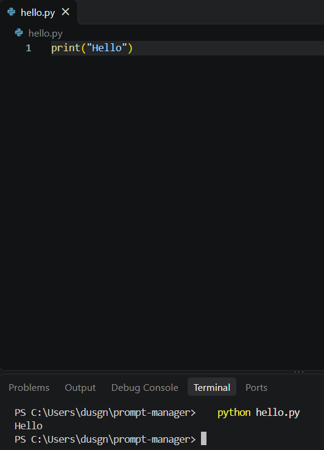

> 처음에는 코드 앞에 공백이 들어가 `IndentationError: unexpected indent`가 발생했고, 공백을 지운 뒤 정상 실행했습니다.

### 3-2. Python / Git 버전 확인

실행한 명령과 결과입니다.

```
PS C:\Users\dusgn\prompt-manager> python --version
Python 3.15.2
PS C:\Users\dusgn\prompt-manager> git --version
git version 2.56.0.windows.4
```

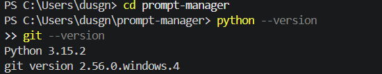

Python 3.15.2는 요구 조건(3.10 이상)을 충족합니다.

### 3-3. Git 사용자 정보 및 기본 브랜치 설정

```
git config --global user.name "dusgn0330"
git config --global user.email "dusgn0330@naver.com"
git config --global init.defaultBranch main
git config --list
```

`git config --list` 출력에서 확인한 값입니다.

```
user.name=dusgn0330
user.email=dusgn0330@naver.com
init.defaultbranch=main
```

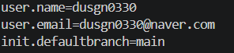

### 3-4. VSCode GitHub 로그인

VSCode 계정 메뉴에 GitHub 계정(`dusgn0330`)이 연결된 것을 확인했습니다.

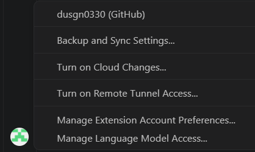

---

## 4. 기능 목록과 사용 예시

### 4-1. 메뉴와 정상 입력 흐름

프로그램을 실행하면 메뉴가 출력되고, 번호를 입력하면 해당 기능이 실행됩니다. 기능이 끝나면 메뉴로 돌아오고, `0`을 입력하면 종료합니다.

| 번호 | 기능 | 설명 |
|---|---|---|
| 1 | 프롬프트 추가 | 제목, 내용, 카테고리를 입력해 등록 |
| 2 | 프롬프트 목록 | 번호, 카테고리, 제목, 즐겨찾기 여부(⭐) 출력 |
| 3 | 카테고리별 조회 | 카테고리를 선택해 해당 프롬프트만 출력 |
| 4 | 프롬프트 검색 | 제목 또는 내용에 키워드가 포함된 프롬프트 검색 |
| 5 | 프롬프트 상세 보기 | 번호를 입력해 전체 내용 출력 |
| 6 | 즐겨찾기 관리 | 번호를 입력해 즐겨찾기 추가 또는 해제 (토글) |
| 7 | 즐겨찾기 목록 | 즐겨찾기한 프롬프트만 출력 |
| 0 | 종료 | 프로그램 종료 |

정상 입력 흐름 예시입니다. (메뉴에서 `2`를 입력)

```
=== 나만의 프롬프트 관리 ===
1. 프롬프트 추가
...
0. 종료
선택: 2

=== 프롬프트 목록 ===
1. [자동화] 자동화 워크플로우 설계 도우미
2. [자동화] 기상청 API 데이터 가공 도우미
3. [텍스트 생성] 자동화 도구 비교 보고서
4. [텍스트 생성] 우산 알림 메일 문구 작성
5. [페르소나] 노코드 자동화 멘토
총 5개의 프롬프트
```

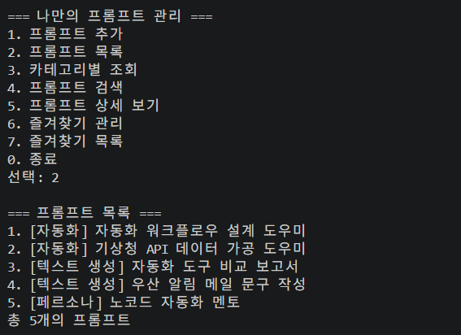

### 4-2. 프롬프트 추가

**입력 예시 (한 줄 요약):** 제목 `블로그 글 작성 도우미` / 내용 `당신은 10년 경력의 전문 블로거입니다. ...` / 카테고리 `1`(텍스트 생성)

```
선택: 1
=== 프롬프트 추가 ===
제목: 블로그 글 작성 도우미
내용: 당신은 10년 경력의 전문 블로거입니다. 주어진 주제에 대해 SEO에 최적화된 블로그 글을 작성해주세요. ...
카테고리 선택:
1) 텍스트 생성
2) 이미지 생성
3) 영상 생성
4) 페르소나
5) 자동화
6) 기타
0) 직접 입력
선택: 1
프롬프트가 추가되었습니다!
```

입력값이 비어 있으면 다시 입력을 요청합니다. (`input_required()`)

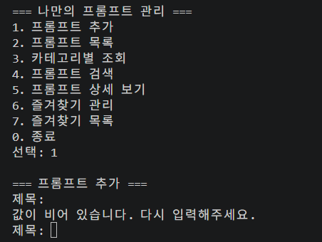

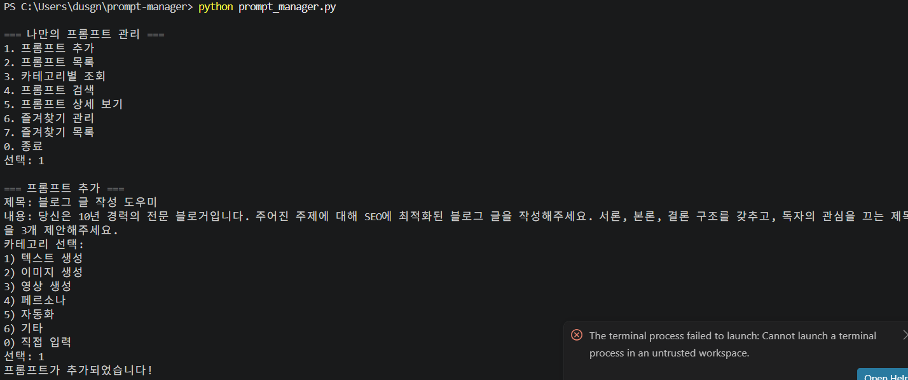

추가한 프롬프트의 `favorite` 기본값은 `False`입니다.

### 4-3. 프롬프트 목록

기본 프롬프트 5개와 실행 중 추가한 3개, 총 8개가 표시됩니다. 프롬프트가 없으면 "등록된 프롬프트가 없습니다."를 출력합니다.

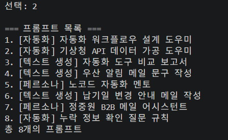

### 4-4. 카테고리별 조회

**선택 방식:** 카테고리 목록(1~6)에서 번호를 입력합니다.
**출력 형태:** 선택한 카테고리의 프롬프트만 번호와 함께 출력하고, 마지막에 개수를 표시합니다. 해당 카테고리에 프롬프트가 없으면 안내 메시지를 출력합니다.

```
선택: 3

=== 카테고리별 조회 ===
1) 텍스트 생성
2) 이미지 생성
3) 영상 생성
4) 페르소나
5) 자동화
6) 기타
선택: 1

[텍스트 생성] 카테고리 프롬프트:
1. 자동화 도구 비교 보고서
2. 우산 알림 메일 문구 작성
3. 블로그 글 작성 도우미
총 3개의 프롬프트
```

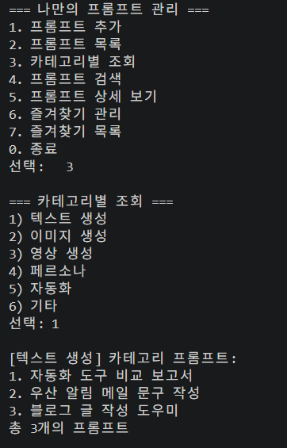

### 4-5. 프롬프트 검색

**검색 대상은 제목과 내용 모두입니다.** 입력한 키워드가 제목 또는 내용에 포함되어 있으면 결과에 나오며, 대소문자는 구분하지 않습니다. 결과가 없으면 "검색 결과가 없습니다."를 출력합니다.

```
검색어: 메일
검색 결과:
1. [텍스트 생성] 우산 알림 메일 문구 작성
1개의 프롬프트를 찾았습니다.
```

메뉴에 없는 값(`zds`)을 입력하면 안내 메시지 후 메뉴가 다시 표시됩니다.

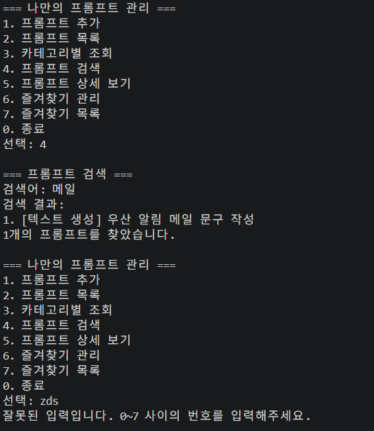

### 4-6. 프롬프트 상세 보기

번호를 입력하면 제목, 카테고리, 즐겨찾기 여부, 내용 전체를 출력합니다. 범위를 벗어난 번호를 입력하면 안내 메시지를 출력합니다.

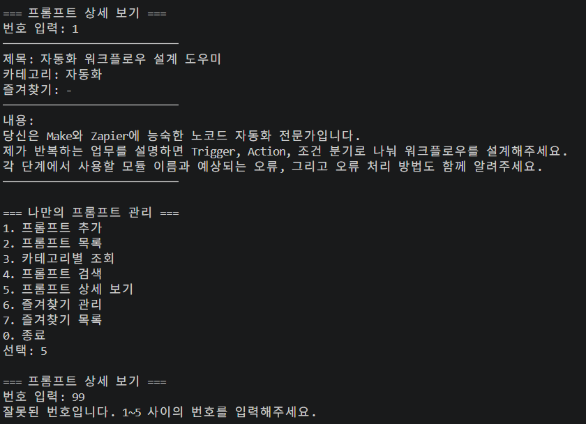

### 4-7. 즐겨찾기 관리 (추가/해제)

같은 번호를 다시 입력하면 해제되는 **토글** 방식입니다.

```
=== 즐겨찾기 관리 ===
프롬프트 번호 입력: 1
'자동화 워크플로우 설계 도우미' 프롬프트를 즐겨찾기에 추가했습니다!

(같은 번호를 한 번 더 입력하면)
'자동화 워크플로우 설계 도우미' 프롬프트를 즐겨찾기에서 해제했습니다.
```

즐겨찾기 목록에서는 ⭐와 함께 모아서 볼 수 있습니다. 없으면 "즐겨찾기한 프롬프트가 없습니다."를 출력합니다.

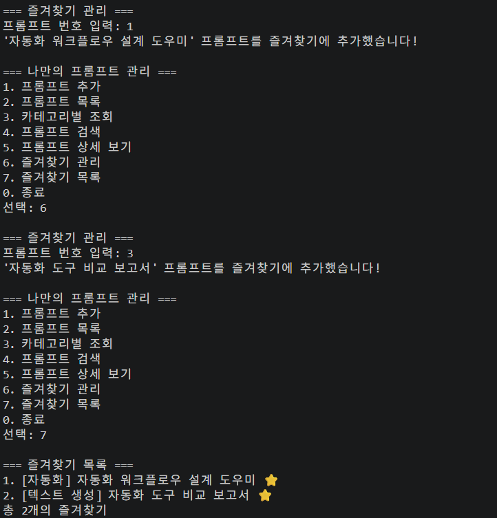

---

## 5. 코드 구조와 설계

### 5-1. 함수별 역할

기능별로 함수를 분리했고, 각 함수는 하나의 책임만 가집니다.

| 함수 | 책임 |
|---|---|
| `show_menu()` | 메뉴 화면만 출력한다 |
| `main()` | 메뉴 번호를 입력받아 알맞은 기능 함수를 호출하고, 종료 여부를 판단한다 |
| `input_required(message)` | 빈 값이 아닌 입력이 들어올 때까지 반복해서 입력받는다 |
| `choose_category()` | 카테고리 목록에서 번호로 선택하거나 직접 입력한 카테고리를 반환한다 |
| `add_prompt()` | 제목, 내용, 카테고리를 받아 `prompts` 리스트에 추가한다 |
| `show_list()` | 전체 프롬프트를 번호와 함께 출력한다 |
| `show_by_category()` | 선택한 카테고리의 프롬프트만 필터링해 출력한다 |
| `search_prompt()` | 제목 또는 내용에 키워드가 포함된 프롬프트를 찾아 출력한다 |
| `show_detail()` | 번호로 선택한 프롬프트의 전체 내용을 출력한다 |
| `toggle_favorite()` | 번호로 선택한 프롬프트의 즐겨찾기 값을 반전시킨다 |
| `show_favorites()` | 즐겨찾기한 프롬프트만 모아 출력한다 |

### 5-2. 데이터 구조와 접근 방법

프롬프트는 **리스트 안의 딕셔너리**로 저장합니다.

```python
prompts = [
    {"title": "제목", "content": "내용", "category": "카테고리", "favorite": False},
]

prompts[0]["title"]            # 첫 번째 프롬프트의 제목 조회
prompts[0]["favorite"] = True  # 첫 번째 프롬프트를 즐겨찾기로 변경
```

**리스트 + 딕셔너리를 선택한 이유**

- 장점: 리스트는 입력 순서가 유지되어 목록 번호(1, 2, 3...)와 인덱스를 바로 대응시킬 수 있습니다. 딕셔너리는 `"title"`, `"favorite"`처럼 키 이름으로 접근해 코드가 읽기 쉽고, 필드를 추가하기도 쉽습니다.
- 단점: 검색할 때 리스트를 처음부터 끝까지 확인해야 하고(데이터가 많아지면 느려짐), 키 이름 오타를 막아주는 장치가 없으며, 중복 제목을 자동으로 막지 못합니다.

### 5-3. 메인 반복문(while)의 설계

`main()`은 `while True:` 반복문으로 메뉴를 계속 보여줍니다.

- **종료 조건:** 사용자가 `0`을 입력하면 `break`로 반복문을 빠져나가 프로그램이 종료됩니다.
- **설계 의도:** 기능 하나가 끝날 때마다 메뉴로 돌아와 여러 기능을 이어서 쓸 수 있게 하고, 잘못된 입력이 들어와도 프로그램이 멈추지 않고 안내 후 다시 메뉴를 보여주기 위해서입니다.

### 5-4. 입력 검증 (빈 값, 번호 범위)

| 상황 | 처리 |
|---|---|
| 제목/내용/검색어가 빈 값 | `값이 비어 있습니다. 다시 입력해주세요.` 출력 후 다시 입력 요청 |
| 메뉴 번호가 0~7이 아님 | `잘못된 입력입니다. 0~7 사이의 번호를 입력해주세요.` 출력 후 메뉴 재표시 |
| 상세 보기/즐겨찾기 번호가 범위 밖 | `잘못된 번호입니다. 1~N 사이의 번호를 입력해주세요.` 출력 (N은 현재 프롬프트 수) |
| 카테고리 번호가 1~6이 아님 | 추가 시 `잘못된 입력입니다. 다시 선택해주세요.` 후 재선택, 조회 시 `잘못된 입력입니다.` 출력 |
| 숫자가 아닌 값 입력 | `isdigit()`으로 검사해 위와 같은 안내 메시지를 출력 |

### 5-5. 중복 제목 처리 정책

**현재 정책: 중복 제목을 허용합니다.** 프롬프트는 제목이 아니라 목록 번호로 구분하기 때문에, 같은 제목이 여러 개 있어도 동작에 문제가 없습니다. 같은 제목의 프롬프트도 내용이나 카테고리가 다를 수 있다고 보고 입력을 막지 않았습니다.
(제목을 반드시 고유하게 해야 한다면 `add_prompt()`에서 기존 제목과 비교해 입력을 차단하도록 확장할 수 있습니다.)

### 5-6. 카테고리를 바꾸려면 어디를 고치나

카테고리 목록은 `prompt_manager.py` 맨 위의 `CATEGORIES` 리스트 **한 곳**에서 관리합니다.

```python
CATEGORIES = ["텍스트 생성", "이미지 생성", "영상 생성", "페르소나", "자동화", "기타"]
```

- `choose_category()`(추가 시 선택)와 `show_by_category()`(조회 시 선택)가 이 리스트를 `enumerate`로 읽어서 번호를 자동으로 붙이므로, 리스트만 고치면 두 기능에 함께 반영됩니다.
- 기본 프롬프트(`prompts`)의 `"category"` 값은 직접 쓴 문자열이므로, 카테고리 이름을 바꾸면 이 값도 같이 맞춰야 합니다.
- 참고: 추가할 때 `0) 직접 입력`으로 새 카테고리를 만들 수는 있지만, 카테고리별 조회 목록에는 `CATEGORIES`에 있는 항목만 나옵니다.

### 5-7. 데이터 영속화 설계 (보너스, 이번 제출에는 미구현)

필수 요구사항은 "프로그램 실행 중에만 데이터를 유지"하는 것이라서, 현재는 메모리(리스트)에만 저장하고 종료하면 초기화됩니다. 영속화를 추가한다면 아래처럼 설계할 계획입니다.

- **파일 형식:** JSON (`prompts.json`, UTF-8). 현재 데이터 구조(리스트 안의 딕셔너리)가 JSON과 그대로 대응하고, 파이썬 기본 `json` 모듈로 외부 라이브러리 없이 처리할 수 있으며, 사람이 열어서 읽기도 쉽기 때문입니다.
- **저장 경로:** 프로그램과 같은 폴더의 `prompts.json`.
- **동작:** 시작할 때 파일을 읽어 불러오고(파일이 없으면 기본 프롬프트 사용), 추가/즐겨찾기 변경 후 또는 종료할 때 저장합니다.

---

## 6. 기본 프롬프트 데이터와 카테고리

이전 미션(자동화 프로젝트 1, 2)을 바탕으로 정리한 프롬프트 5개를 기본 데이터로 등록했습니다.

| 제목 | 카테고리 |
|---|---|
| 자동화 워크플로우 설계 도우미 | 자동화 |
| 기상청 API 데이터 가공 도우미 | 자동화 |
| 자동화 도구 비교 보고서 | 텍스트 생성 |
| 우산 알림 메일 문구 작성 | 텍스트 생성 |
| 노코드 자동화 멘토 | 페르소나 |

| 카테고리 | 설명 |
|---|---|
| 텍스트 생성 | 글, 보고서, 메일 등 텍스트를 만드는 프롬프트 |
| 이미지 생성 | 이미지 생성용 키워드와 지시문 |
| 영상 생성 | 영상, 스크립트 제작용 프롬프트 |
| 페르소나 | AI에게 역할을 부여하는 프롬프트 |
| 자동화 | Make, Zapier 같은 노코드 자동화 설계용 프롬프트 |
| 기타 | 위에 속하지 않는 프롬프트 |

---

## 7. Git 작업 기록

### 7-1. 커밋 규칙과 기록

기능 하나를 완성할 때마다 커밋했고, 커밋 메시지는 `종류: 변경 내용` 형식으로 통일했습니다.

| 접두어 | 의미 | 예시 |
|---|---|---|
| `feat:` | 기능 추가 | `feat: 키워드 검색 기능` |
| `docs:` | 문서 수정 | `docs: README 작성` |
| `chore:` | 초기 설정 등 잡무 | `chore: README, .gitignore 초기 생성` |
| `merge:` | 브랜치 병합 | `merge: feature/list 브랜치 병합` |

`git log --oneline --graph` 결과입니다. 총 13개 커밋입니다.

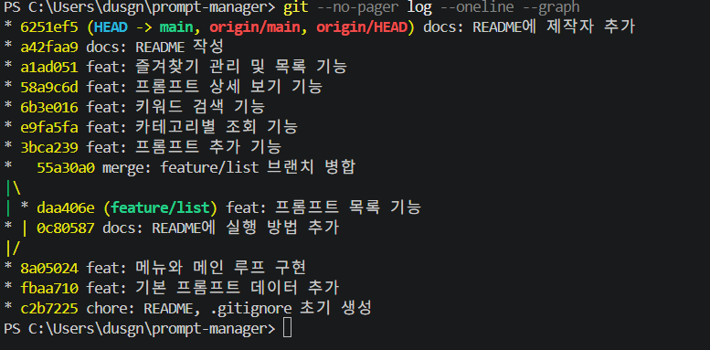

### 7-2. 브랜치 분리와 병합

**브랜치를 나눈 기준:** 목록 기능(`show_list()`)은 메뉴/데이터 작업과 독립적인 첫 기능이라, 과제 요구에 따라 `feature/list` 브랜치에서 따로 작업했습니다. 작업이 실패해도 `main`이 영향을 받지 않도록 분리했습니다.

**병합 시점(완료 조건):** 목록 기능을 구현해 프로그램에서 `2`를 눌렀을 때 프롬프트 목록이 정상 출력되는 것을 확인하고 커밋한 직후 병합했습니다.

**실제 사용한 명령:**

```
git checkout -b feature/list     # 브랜치 생성 및 이동
(show_list() 작성 후)
git add .
git commit -m "feat: 프롬프트 목록 기능"
git checkout main                # main으로 이동
(README 수정 후)
git add .
git commit -m "docs: README에 실행 방법 추가"
git merge feature/list --no-ff -m "merge: feature/list 브랜치 병합"
git push
```

`main`에도 커밋이 하나 더 있어 두 브랜치가 갈라진 상태였고, `--no-ff` 옵션으로 병합 커밋(`55a30a0`)을 남겼습니다. 이번 병합에서는 충돌이 발생하지 않았습니다.

### 7-3. 병합 충돌이 발생하면 (처리 절차)

1. **원인 파악:** `git status`로 충돌한 파일(`both modified`)을 확인하고, 파일을 열어 `<<<<<<<`, `=======`, `>>>>>>>` 표시로 두 브랜치의 변경 내용을 비교합니다.
2. **수정:** 남길 내용을 정해 충돌 표시를 지우고 코드를 정리합니다.
3. **검증:** `python prompt_manager.py`를 실행해 메뉴와 변경된 기능이 정상 동작하는지 테스트합니다.
4. **마무리:** `git add .` → `git commit`으로 병합을 완료하고 `git push`합니다.

### 7-4. 첫 푸시

```
git branch -M main
git remote add origin https://github.com/dusgn0330/prompt-manager.git
git push -u origin main
```

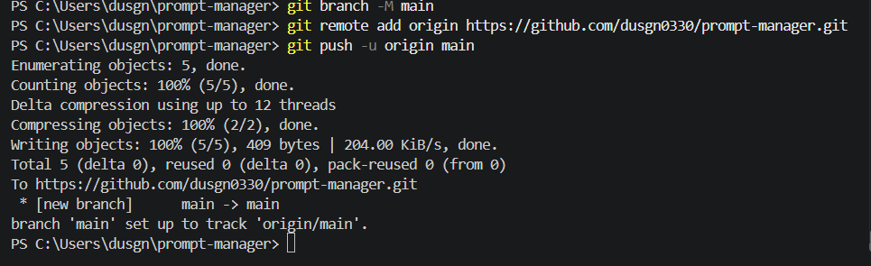

### 7-5. clone 실습

공개 샘플 저장소를 내려받아 폴더 구조와 커밋 로그를 확인했습니다.

```
git clone https://github.com/octocat/Hello-World.git
cd Hello-World
git log --oneline
dir
```

<!-- clone 실행 화면을 images/15-clone-log.png로 저장한 뒤 아래 줄의 주석을 해제하세요.

-->

### 7-6. 사용한 Git 명령어 정리

| 명령어 | 사용한 곳 |
|---|---|
| init | 프로젝트 폴더에서 로컬 저장소 시작 |
| add / commit | 기능 단위로 커밋 (총 13개) |
| push | 원격 저장소(GitHub)에 업로드 |
| clone | 공개 샘플 저장소를 내려받아 구조와 로그 확인 |
| checkout | `feature/list` 브랜치 생성 및 `main` 복귀 |
| merge | `feature/list`를 `main`에 병합 (`--no-ff`) |
| pull | GitHub 웹에서 수정한 README를 로컬로 가져옴 |

---

## 8. 요구사항 체크리스트

- [x] 콘솔 메뉴 기반 프로그램 (추가, 목록, 카테고리별 조회, 검색, 상세 보기, 즐겨찾기)
- [x] 리스트와 딕셔너리로 데이터 저장, 기본 프롬프트 3개 이상 (5개)
- [x] 기능별 함수 분리(함수 11개), 외부 라이브러리 미사용
- [x] GitHub 저장소 업로드
- [x] 의미 있는 커밋 10개 이상 (13개)
- [x] 브랜치 생성 및 병합 기록
- [x] init, add, commit, push, pull, checkout, clone, merge 각 1회 이상 사용
- [x] README.md 작성 (프로그램 설명, 실행 방법, 기능 목록, 카테고리 설명)
